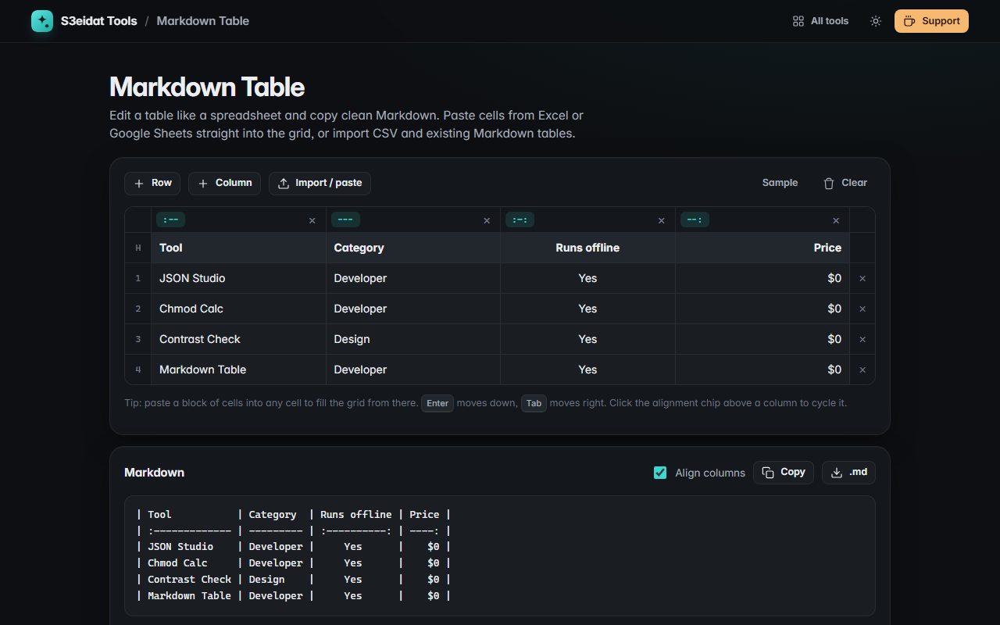

# Markdown Table

> Create and edit Markdown tables visually, like a spreadsheet. Free, private, and it runs entirely in your browser.

### ▶ [Open Markdown Table](https://s3eidat.github.io/markdown-table/)



## Features

- **Spreadsheet-style grid**: type in cells, <kbd>Enter</kbd> moves down (and adds a row at the end), <kbd>Tab</kbd> moves right
- **Add or delete** rows and columns
- **Alignment per column** (none, left, center, right), shown as `---`, `:--`, `:-:`, `--:`
- **Paste a block of cells** from Excel or Google Sheets into any cell and the grid grows to fit
- **Import** CSV (comma or semicolon, quoted fields), TSV, or an existing **Markdown table** (alignment is kept)
- Output as **neatly aligned** Markdown or compact Markdown; pipes are escaped as `\|`, line breaks become `<br>`
- Copy or download `table.md`; your table is remembered on this device

## Privacy

Your table never leaves your device. There is no server, no account, no analytics.
The page ships with a strict Content-Security-Policy (`connect-src 'self'`), so the browser
itself blocks any attempt to send data anywhere.

## Run it yourself

It's plain HTML, CSS and JavaScript with no build step:

```bash
git clone https://github.com/s3eidat/markdown-table
cd markdown-table
python -m http.server 8000
```

Then open http://localhost:8000.

## Support

If this saved you time, **[buy me a coffee ☕](https://s3eidat.github.io/coffee/)**. It keeps every tool free.

---

Part of **[S3eidat Tools](https://s3eidat.github.io/)**: 100+ free, private tools that run in your browser. MIT licensed.
